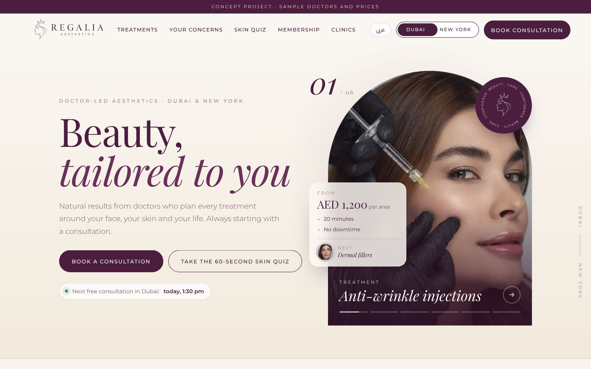
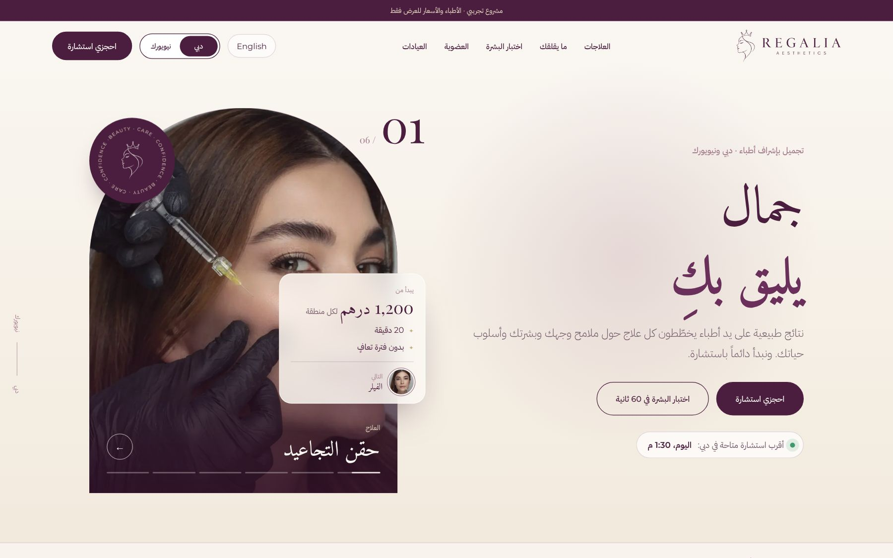
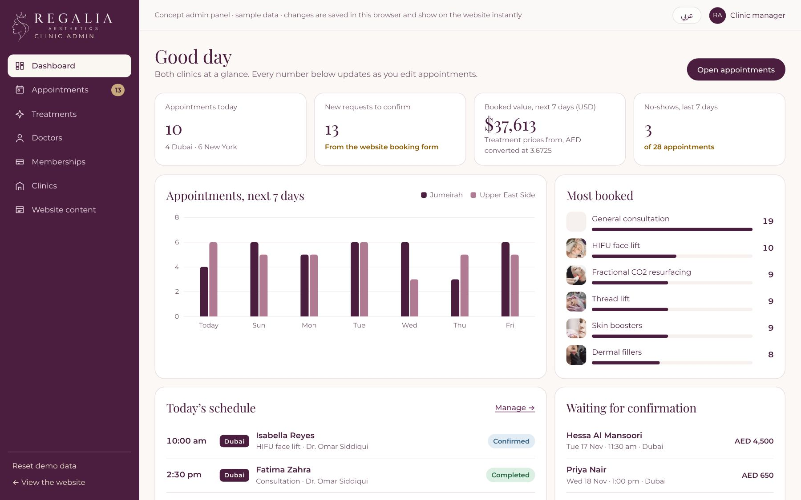

# Regalia Aesthetics

**Bilingual clinic website with booking and a custom admin panel** · designed and built by **Arooj Fatima**

A booking website and admin panel for a doctor-led aesthetics clinic with branches in Dubai and New York. Visitors explore treatments on an interactive face map, take a 60-second skin quiz and book a consultation. The whole site and the admin switch to Arabic, right to left.

## Tech
- React 19
- TypeScript
- esbuild
- Arabic RTL

## Notes
Self-initiated concept project with sample data, built to the standard of client work. No real bookings, orders or payments are made.

The full case study, with the design decisions behind it, is on my portfolio.

---

## Project details
Doctor-led skin and aesthetics clinic in Jumeirah, Dubai and the Upper East Side, New York. Concept portfolio project by Arooj Fatima. Doctors, prices and addresses are samples.

## What's in it
- **Home:** animated hero (the client's logo revealed in an arch, live "next free consultation"), interactive face map (tap a concern to see treatments, prices and downtime), signature treatments, skin quiz band, day-by-day treatment journey, the clinic, doctors per city, membership tiers with a savings calculator, both clinics with live local time.
- **Treatments (#treatments):** filter by category, concern and "no downtime"; each treatment has its own page (#treatment-hifu etc.) with prices per city, journey, FAQs and booking.
- **Skin quiz (#quiz):** five questions, then a plan with sessions, total estimate and time to results, passed into booking.
- **Booking (#book):** clinic, doctor, date and time (in the clinic's local time), details with validation, confirmation.

Photography: Pexels (free licence), photo IDs 34775442, 34775253, 12556701, 12556700, 7216285, 14438369, 7582560, 34775443, 34220532, 30809948, 37229301, 18209809, 37229279, 4586726, 3738355, 16032305, 36930299, 7581581, 5327579, 20100299, 5234501, 4989130, 3762763.

The logo is the client's own artwork, cut out from the supplied file (plum and ivory versions). Nothing is redrawn.

## Stack
React 19 + TypeScript, views map to Next.js app routes. Designed for a Laravel API:
`GET /api/clinics`, `GET /api/treatments`, `GET /api/doctors`, `GET /api/availability?clinic=dxb&doctor=…&date=…`, `POST /api/bookings`.

## Preview build
`node preview/build.mjs` writes `dist/` and a single-file `dist/regalia-aesthetics.html`.

## Admin panel (#admin)
Built into the same app and wired to the website. Everything is saved in the browser (the full build saves to Laravel):
- **Dashboard:** today's appointments, requests to confirm, booked value for the week, no-shows, appointments per day per clinic, most booked treatments, today's schedule.
- **Appointments:** day strip, both clinics or one, search, requests filter, one-click confirm, status changes, add/edit/delete bookings. Website bookings arrive here and booked times disappear from the website.
- **Treatments:** add, edit, hide or delete; photo upload, prices per city, downtime, sessions, face-map concerns, signature flag, step-by-step journey and FAQs.
- **Doctors:** add, edit, remove; photo, role, clinic, bio, quote, specialties, languages.
- **Memberships:** plans, prices, perks and the featured plan.
- **Clinics:** address, phone, opening hours (also used for booking slots), consultation fee, licensing line.
- **Website content:** hero text, closing line and the hero slideshow (upload, caption, link, reorder, remove).

---

**Arooj Fatima** · Full-stack developer who designs · Portfolio: [aroojfatima-portfolio.netlify.app](https://aroojfatima-portfolio.netlify.app) · aroojfatimaofficial250@gmail.com
